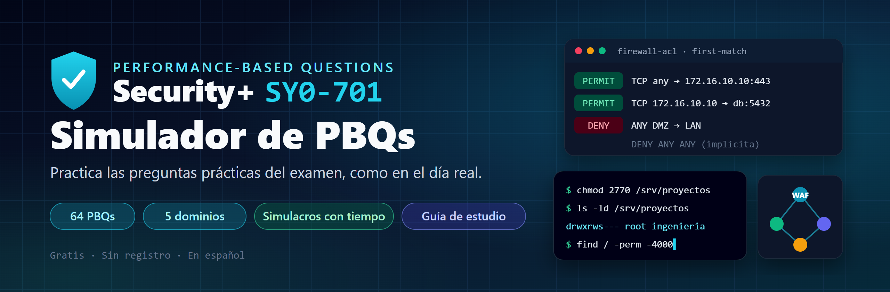
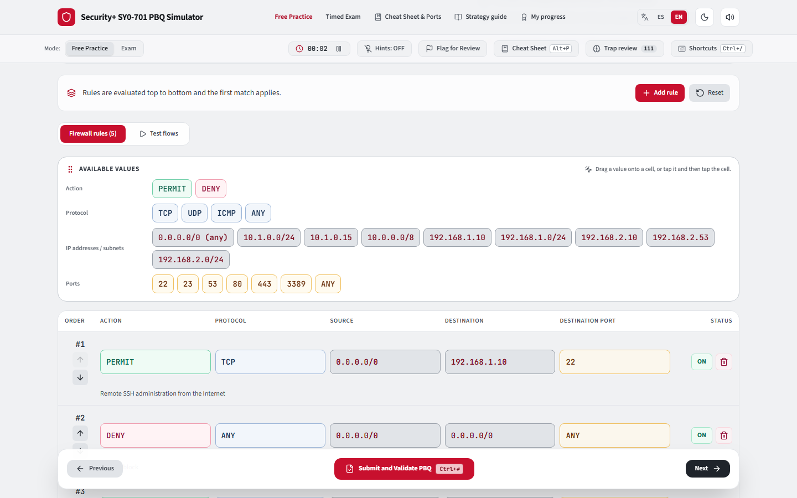
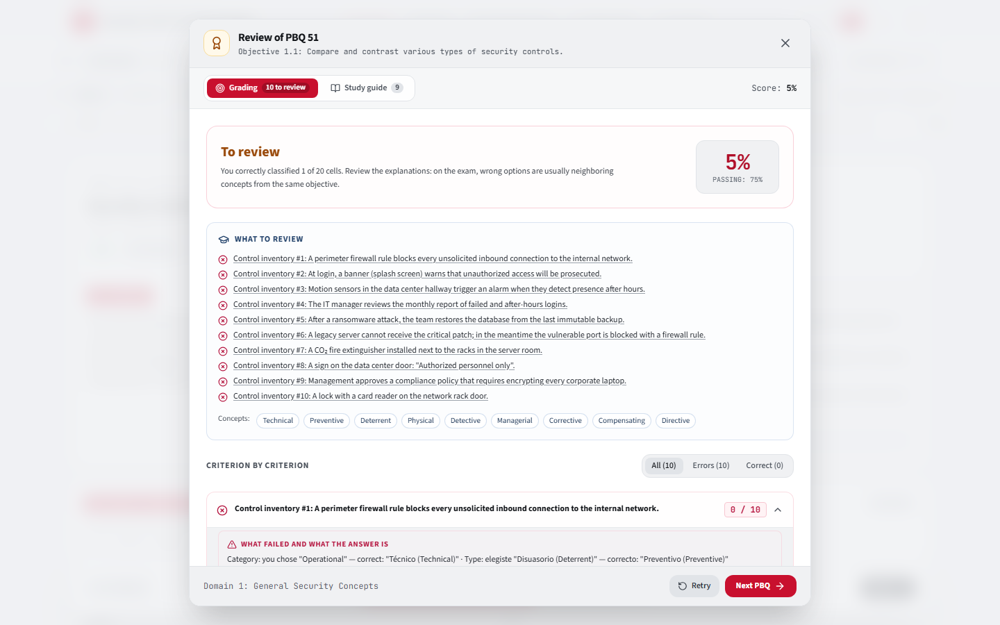
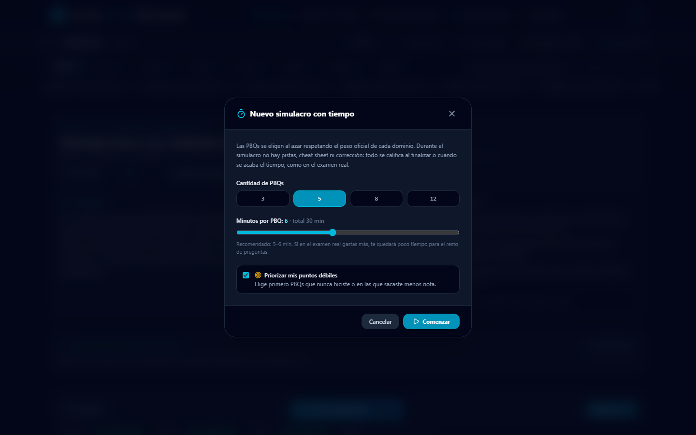
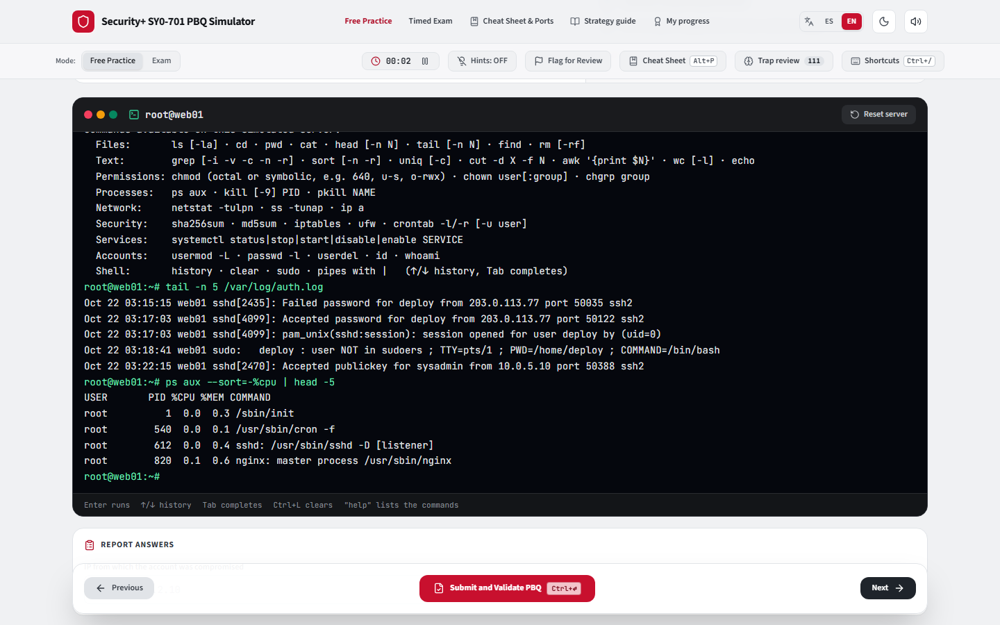
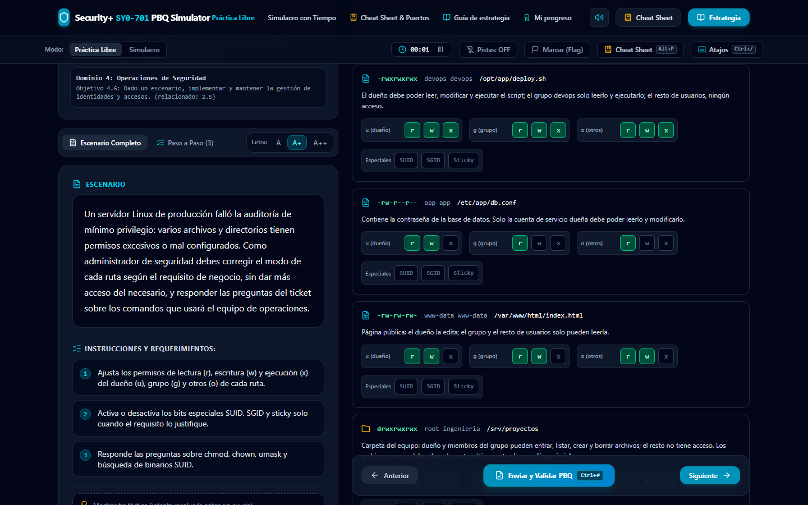
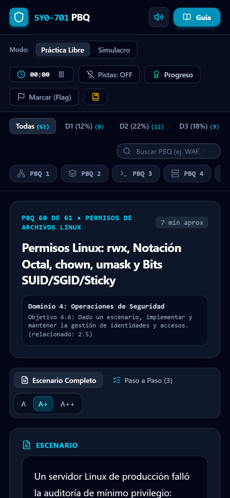

<div align="center">

<a href="https://enzop7.github.io/Comptia-PBQ/"></a>

# Simulador de PBQs · Security+ SY0-701

**Practica gratis las Performance-Based Questions del examen CompTIA Security+ SY0-701, en español o en inglés.**<br />
*Free CompTIA Security+ SY0-701 PBQ practice, in Spanish or English.*<br />
Escenarios interactivos, corrección criterio por criterio y simulacros con tiempo, como el día del examen.

<a href="https://enzop7.github.io/Comptia-PBQ/"></a>


</div>

---

## ¿Qué son las PBQs y por qué practicarlas?

Las **PBQs (Performance-Based Questions)** son las preguntas prácticas del examen Security+: en lugar de elegir una respuesta, tienes que **hacer** algo. Por ejemplo: ordenar las reglas de un firewall, ubicar controles en un diagrama de red, analizar logs de un SIEM, asignar permisos o clasificar ataques. Suelen aparecer al principio del examen, consumen mucho tiempo y son donde más puntos se pierden por falta de práctica.

Este simulador reúne **92 PBQs originales** que cubren los cinco dominios y los 28 objetivos del SY0-701 (cada objetivo tiene al menos una PBQ que lo evalúa como objetivo principal), con la misma mecánica que vas a encontrar en el examen.

<p align="center"></p>

## Español o inglés

Al entrar por primera vez eliges el idioma en la pantalla de bienvenida, y puedes cambiarlo cuando quieras con el selector **ES / EN** de la barra superior. Todo se traduce: enunciados, opciones, terminal, corrección y guía de estudio. Tu progreso es el mismo en los dos idiomas.

*On your first visit you pick the language on the welcome screen, and you can switch at any time with the **ES / EN** toggle in the top bar. Everything is translated: scenarios, options, terminal, grading and study guide. Your progress is shared between both languages.*

## Cómo funciona

### 1. Práctica libre
Elige cualquier PBQ en la barra superior (puedes filtrar por dominio, por las que no hiciste o por las que fallaste), resuélvela y pulsa **Enviar y validar**. La calificación es con **crédito parcial**: cada criterio suma puntos y se aprueba con 75%.

### 2. Corrección que enseña
Al validar ves, **criterio por criterio**:
- **qué elegiste y cuál era la respuesta correcta**;
- **por qué** esa es la respuesta en ese escenario;
- los **conceptos** que debes dominar, con su definición y la **trampa típica del examen**;
- un bloque **"Qué repasar"** con tus errores, y una **guía de estudio** de cada PBQ.

<p align="center"></p>

### Dificultad como el examen real
Cada PBQ indica su nivel. **Básica** e **Intermedia** se parecen a lo que reportan quienes ya rindieron el SY0-701: entre 2 y 5 PBQs cortas (reglas de firewall, identificar ataques o equipos comprometidos en logs, emparejar conceptos, configurar una VPN o un certificado). **Avanzada** va más allá del examen (terminal libre, muchas zonas o servicios a la vez) y sirve para reforzar. Puedes filtrar por nivel, y el simulacro usa por defecto solo PBQs básicas e intermedias.

Las PBQs marcadas como **Extra: puede no aparecer** (25, 32, 42, 60, 62, 63, 64 y 76) tratan temas que no figuran en los objetivos del SY0-701: línea de comandos, Nmap, chmod y ataques a Active Directory. El SY0-701 eliminó la lista de herramientas de consola que tenía el SY0-601. Están al final de la lista para darles una mirada general y no entran en el simulacro "como el examen real".

### 3. Pistas apagadas por defecto
En el examen real no hay ayudas, así que aquí tampoco, salvo que las actives. El botón **Pistas** enciende medidores de cumplimiento, explicaciones de cada opción, el simulador de tráfico del firewall y un tip táctico. Úsalas para aprender, no para medirte.

### 4. Simulacro con tiempo
Elige **cuántas PBQs** (3, 5, 8 o 12) y **cuántos minutos por PBQ**. Las preguntas salen al azar respetando el **peso oficial de cada dominio**, y puedes **priorizar tus puntos débiles** (las que nunca hiciste o en las que sacaste menos nota). Durante el simulacro no hay pistas, ni cheat sheet, ni pausa, ni corrección: todo se califica al finalizar o cuando se acaba el tiempo. Después puedes revisar cada PBQ.

<p align="center"></p>

### 5. Repaso de trampas
Más de 100 tarjetas con los pares de conceptos que más se confunden en el examen (PEP vs. motor de políticas, DDoS reflejado vs. amplificado, journaling vs. replicación, tolerancia vs. umbral…). Eliges entre dos opciones y la app te muestra la palabra clave que los diferencia y la PBQ donde practicarlo. Usa repetición espaciada: las que fallas vuelven en la misma ronda y al día siguiente; las que aciertas se espacian hasta 30 días. Se abre con el botón **Repaso de trampas** o con <kbd>Alt</kbd> + <kbd>T</kbd>.

### 6. Tu progreso es privado
No hay cuentas ni registro. Respuestas, notas, marcas e historial de intentos se guardan **solo en tu navegador**. El reporte de progreso muestra tu desempeño por dominio oficial.

## Formatos de PBQ que vas a practicar

| Formato | Ejemplos |
|---|---|
| 🧱 **Reglas de firewall / ACL** | Arrastrar acciones, protocolos, IPs y puertos a cada regla (o tocar y colocar en el celular), ordenar las reglas *first-match*, egress filtering, DMZ multizona. Se corrige enviando paquetes de prueba reales por tu tabla. |
| 🗺️ **Diagramas de red** | Ubicar WAF, IPS, bastion host, RADIUS, ZTNA, transit gateway. |
| 📜 **Análisis de logs / SIEM** | Paciente cero, línea de tiempo, Kerberoasting, beaconing C2, MITRE ATT&CK. |
| ⚙️ **Configuración** | Wi-Fi WPA3-Enterprise, VPN IPsec, PKI y certificados, SPF/DKIM/DMARC, cabeceras HTTP, contenedores, MDM. |
| 💻 **Terminal Linux interactiva** | Una consola simulada donde escribes comandos: investiga `auth.log`, `ps aux`, `ss -tunap`, `crontab`; bloquea con `iptables`/`ufw`; corrige permisos y SUID con `find`/`chmod`; verifica integridad con `sha256sum`; analiza logs con `grep | sort | uniq -c`. Se corrige por el estado final del servidor. |
| 🐧 **Línea de comandos (selección)** | Permisos Linux (`chmod`, `chown`, `umask`, SUID/SGID/sticky), `netstat`, `tcpdump`, hashes, Nmap, Snort/YARA. |
| 🧩 **Clasificación (arrastrar y soltar)** | Categorías y tipos de controles, ataques a aplicaciones desde logs, actores de amenaza, acuerdos con terceros, pentesting, riesgo y BIA. |
| 🔢 **Orden y cálculo** | Orden de volatilidad, ciclo de respuesta a incidentes, SLE/ALE con valores distintos en cada intento. |

<p align="center"></p>

<p align="center"></p>

## Catálogo de PBQs por dominio

<details>
<summary><b>Dominio 1: Conceptos Generales de Seguridad</b> — 12% del examen · 11 PBQs</summary>

| # | PBQ | Objetivo |
|---|---|---|
| 6 | Conexión Sitio a Sitio IPSec y Cifrado de Datos en Reposo | 1.4 |
| 13 | Diagnóstico de Errores en Cadena de Certificados PKI y Web TLS | 1.4 |
| 19 | Diseño de Seguridad Física y Protección de Centro de Datos | 1.2 |
| 34 | Implementación de Zero Trust Architecture (ZTA) según NIST SP 800-207 | 1.2 |
| 37 | Gestión de Ciclo de Vida PKI, Formatos X.509 (.PFX/.PEM), OCSP Stapling y Key Escrow | 1.4 |
| 51 | Clasificación de Controles de Seguridad: Categoría × Tipo | 1.1 |
| 52 | Proceso de Gestión de Cambios: Elementos de Negocio e Implicaciones Técnicas | 1.3 |
| 61 | Hashing, Salting, Key Stretching, Firmas Digitales y Protección de Claves | 1.4 |
| 71 | Certificados Digitales y PKI: Wildcard, SAN, CSR y Revocación | 1.4 |
| 78 | Zero Trust: Plano de Control, Plano de Datos, PEP y Tecnologías de Engaño | 1.2 |
| 79 | Niveles de Cifrado, Algoritmos y Herramientas de Claves | 1.4 |

</details>

<details>
<summary><b>Dominio 2: Amenazas, Vulnerabilidades y Mitigaciones</b> — 22% del examen · 16 PBQs</summary>

| # | PBQ | Objetivo |
|---|---|---|
| 4 | Aseguramiento de Servidor Web y Líneas Base de Seguridad | 2.5 |
| 11 | Endurecimiento de Estación de Trabajo (VBA, Credential Guard & LLMNR) | 2.5 |
| 14 | Detección y Mitigación de Rogue AP y Ataques Evil Twin (WIPS) | 2.4 |
| 21 | Identificación de Vectores de Ingeniería Social y Factores Humanos | 2.2 |
| 28 | Identificación de Ataques Criptográficos y Selección de Contramedidas | 2.4 |
| 40 | Matriz de Ataques de Ingeniería Social, Disparadores Psicológicos y Defensas | 2.2 |
| 42 | Investigación de Ataques a Active Directory, Telemetría SIEM y MITRE ATT&CK | 2.4 |
| 45 | Triage de Malware: Amenazas a Endpoints, Criptografía y Persistencia en Memoria | 2.4 |
| 46 | Triage de Malware: Amenazas de Red, Código Latente y Evasión Polimórfica | 2.4 |
| 47 | Auditoría de Seguridad de APIs REST: BOLA, SSRF, JWT Tampering y Rate Limiting | 2.3 |
| 55 | Identificación de Ataques a Aplicaciones desde Logs y Payloads | 2.3 |
| 56 | Perfilado de Actores de Amenaza, Motivaciones y Tecnologías de Engaño | 2.1 |
| 63 | Terminal Linux: Auditoría de Hardening, SUID e Integridad de Binarios | 2.5 |
| 80 | Vectores de Amenaza y Tipos de Vulnerabilidad | 2.2 |
| 81 | Indicadores de Actividad Maliciosa: Distinguir Ataques Parecidos | 2.4 |
| 92 | Indicadores en los Registros y Temas Sueltos del SY0-701 | 2.4 |

</details>

<details>
<summary><b>Dominio 3: Arquitectura de Seguridad</b> — 18% del examen · 13 PBQs</summary>

| # | PBQ | Objetivo |
|---|---|---|
| 1 | Diseño de Perímetro Seguro y Micro-Segmentación | 3.2 |
| 8 | Arquitectura Híbrida Cloud (AWS/Azure) y Zero Trust Ingress | 3.1 |
| 16 | Clasificación de Información Sensible y Controles DLP en 3 Estados | 3.3 |
| 18 | Endurecimiento de Contenedores Docker y Pods de Kubernetes | 3.1 |
| 20 | Continuidad de Negocio, Cálculo de RTO/RPO y Resiliencia | 3.4 |
| 39 | Clasificación de Datos en Cloud Storage, Reglas Regex DLP y CASB Inline | 3.3 |
| 41 | Matriz de Responsabilidad Compartida en la Nube (IaaS vs PaaS vs SaaS) | 3.1 |
| 44 | Técnicas de Ofuscación de Datos, PETs y Niveles de Reversibilidad | 3.3 |
| 49 | Filtrado de Tráfico Multi-Interfaz: WAN, DMZ Pública, LAN Interna y Base de Datos PCI-DSS | 3.2 |
| 68 | Acceso Remoto por VPN: Túnel Completo, Túnel Dividido y Sitio a Sitio | 3.2 |
| 83 | Dispositivos y Atributos de Red: Proxy, NGFW, WAF, IDS, Inline y Fail-Open | 3.2 |
| 84 | Modelos de Arquitectura y sus Consideraciones de Seguridad | 3.1 |
| 85 | Copias de Seguridad, Replicación, Journaling y Pruebas de Resiliencia | 3.4 |

</details>

<details>
<summary><b>Dominio 4: Operaciones de Seguridad</b> — 28% del examen · 39 PBQs</summary>

| # | PBQ | Objetivo |
|---|---|---|
| 2 | Endurecimiento de Reglas de Firewall Corporativo | 4.5 |
| 3 | Investigación de Paciente Cero y Cadena de Ataque | 4.9 |
| 5 | Resolución de Conflicto de Permisos en Compartición de Archivos | 4.6 |
| 7 | Despliegue Wi-Fi Corporativo WPA3 Enterprise | 4.1 |
| 9 | Mitigación de Exfiltración de Datos y Filtrado Egress (Salida) | 4.5 |
| 10 | Investigación de Phishing, Beaconing C2 y Ataque Kerberos | 4.9 |
| 12 | Políticas de Acceso Condicional (Conditional Access) y Zero Trust | 4.6 |
| 15 | Priorización de Vulnerabilidades CVSS v3.1 y Remediación Táctica | 4.3 |
| 17 | Secuencia del Ciclo de Vida de Respuesta a Incidentes NIST | 4.8 |
| 22 | Orden Forense de Volatilidad (RFC 3227) y Verificación de Integridad | 4.8 |
| 24 | Defensa de Correo Electrónico: Registros DNS SPF, DKIM y DMARC | 4.5 |
| 25 | Diagnóstico Táctico de Amenazas por Comandos de Consola (Linux / Windows) | 4.9 |
| 26 | Ingeniería de Detección: Reglas NIPS Snort y Reglas YARA para Malware | 4.5 |
| 27 | Integración Shift-Left de Seguridad en el Pipeline CI/CD | 4.1 |
| 29 | Arquitectura de Autenticación Federada, Tokens y Single Sign-On (SSO) | 4.6 |
| 30 | Consola de Directivas de Dispositivos Móviles Empresariales (MDM / MAM / BYOD) | 4.1 |
| 31 | Auditoría de Puertos en Texto Plano y Migración Criptográfica de Red | 4.5 |
| 32 | Interpretación de Escaneo Nmap y Hardening Táctico de Puertos Abiertos | 4.3 |
| 33 | Hardening de Infraestructura DNS, Cifrado DoT y Mitigación de Ataques | 4.5 |
| 35 | Blindaje de Aplicaciones Web: Cabeceras de Seguridad y TLS 1.3 | 4.1 |
| 36 | Procedimiento de Retención Judicial (Legal Hold), Adquisición Bit-a-Bit y Admisibilidad | 4.8 |
| 38 | Arquitectura WiFi Corporativa: WPA3-Enterprise, 802.1X EAP-TLS y WIPS | 4.1 |
| 48 | Ingeniería de Detección en SIEM y Playbooks Automatizados en SOAR | 4.7 |
| 50 | Hardening de Infraestructura y Migración de Protocolos Legados (SOC 2 / ISO 27001) | 4.5 |
| 57 | Modelos de Control de Acceso, Factores de Autenticación y PAM | 4.6 |
| 60 | Permisos Linux: rwx, Notación Octal, chown, umask y Bits SUID/SGID/Sticky | 4.6 |
| 62 | Terminal Linux: Respuesta a Incidente en un Servidor Web Comprometido | 4.8 |
| 64 | Terminal Linux: Análisis de Logs Web con Tuberías y Bloqueo de Atacantes | 4.9 |
| 65 | Ciclo de Vida de Activos: Adquisición, Inventario, Baja Segura y Retención | 4.2 |
| 66 | Herramientas de Monitoreo de Seguridad y Actividades del SOC | 4.4 |
| 69 | Identificar Equipos Comprometidos a partir de Logs de Red | 4.9 |
| 70 | Protocolos Seguros y sus Puertos | 4.5 |
| 75 | Escribe el Puerto: Servicios y Números de Puerto según el Escenario | 4.5 |
| 76 | Terminal Linux: Permisos con chmod y chown en Notación Octal | 4.6 |
| 77 | Reglas de Firewall de una Oficina: Servidores Publicados, Administración y Navegación | 4.5 |
| 82 | Técnicas de Mitigación y Capacidades de Seguridad Empresarial | 4.5 |
| 86 | Automatización, Orquestación y Gestión de Cambios | 4.7 |
| 87 | Modelos de Acceso, Autenticación y Modelos de Dispositivos Móviles | 4.6 |
| 88 | Respuesta a Incidentes, Forense, Fuentes de Datos y Monitoreo | 4.8 |

</details>

<details>
<summary><b>Dominio 5: Gestión y Supervisión del Programa de Seguridad</b> — 20% del examen · 13 PBQs</summary>

| # | PBQ | Objetivo |
|---|---|---|
| 23 | Análisis Cuantitativo de Riesgo (Fórmulas SLE, ARO, ALE) y Tratamiento | 5.2 |
| 43 | Gobernanza de Datos, Roles de Custodia, Estados del Dato y Sanitización | 5.1 |
| 53 | Acuerdos con Terceros y Jerarquía de Documentos de Gobernanza | 5.3 |
| 54 | Tipos de Pruebas de Penetración, Reconocimiento y Auditorías | 5.5 |
| 58 | Terminología de Gestión de Riesgos y Análisis de Impacto al Negocio (BIA) | 5.2 |
| 59 | Cumplimiento Normativo, Privacidad y Programa de Concienciación | 5.4 |
| 67 | Programa de Concienciación: Temas de Capacitación y Ciclo del Programa | 5.6 |
| 72 | Roles de los Datos: Owner, Controller, Processor, Custodian, Steward y DPO | 5.1 |
| 73 | Estructuras de Gobernanza: Centralizada, Descentralizada, Junta y Comités | 5.1 |
| 74 | Tipos de Acuerdos (SLA, MOU, MOA, MSA, SOW, NDA, BPA) y Evaluación de Proveedores | 5.3 |
| 89 | Terminología de Riesgo y Gestión de Vulnerabilidades | 5.2 |
| 90 | Leyes, Marcos y Conceptos de Cumplimiento | 5.1 |
| 91 | Proveedores, Auditorías, Roles y Concienciación | 5.3 |

</details>

## Atajos de teclado

| Atajo | Acción |
|---|---|
| <kbd>Ctrl</kbd> + <kbd>Enter</kbd> | Validar la PBQ actual (práctica libre) |
| <kbd>Ctrl</kbd> + <kbd>→</kbd> · <kbd>Alt</kbd> + <kbd>→</kbd> | Siguiente PBQ |
| <kbd>Ctrl</kbd> + <kbd>←</kbd> · <kbd>Alt</kbd> + <kbd>←</kbd> | PBQ anterior |
| <kbd>Alt</kbd> + <kbd>E</kbd> | Abrir la corrección y la guía de estudio de la PBQ actual |
| <kbd>Alt</kbd> + <kbd>R</kbd> | Reiniciar las respuestas de la PBQ actual |
| <kbd>Alt</kbd> + <kbd>P</kbd> | Cheat sheet de puertos y conceptos (solo en práctica) |
| <kbd>Alt</kbd> + <kbd>T</kbd> | Repaso de trampas con tarjetas (solo en práctica) |
| <kbd>Alt</kbd> + <kbd>S</kbd> | Reporte de progreso por dominio |
| <kbd>Ctrl</kbd> + <kbd>/</kbd> | Mostrar u ocultar la ayuda de atajos |
| <kbd>Esc</kbd> | Cerrar cualquier ventana |

> En macOS, <kbd>Cmd</kbd> funciona igual que <kbd>Ctrl</kbd>.

## También en el celular

<p align="center"></p>

## Ejecutar en local

Requiere [Node.js](https://nodejs.org/) 20 o superior.

```bash
git clone https://github.com/EnzoP7/Comptia-PBQ.git
cd Comptia-PBQ
npm install
npm run dev      # http://localhost:3000
```

| Comando | Para qué |
|---|---|
| `npm run dev` | Servidor de desarrollo |
| `npm run build` | Build de producción en `dist/` |
| `npm run lint` | Chequeo de tipos |

Cada push a `main` se publica automáticamente en GitHub Pages (`.github/workflows/deploy.yml`).

<details>
<summary><b>Estructura del proyecto y cómo añadir PBQs</b></summary>

| Archivo | Rol |
|---|---|
| `src/pbqRegistry.tsx` | Para cada PBQ: estado inicial, evaluador y simulador. |
| `src/data/pbqsData.ts` | Catálogo de las PBQs 1–50 y sus datos iniciales. |
| `src/data/matrixPbqs.ts` | PBQs de clasificación 51–59, 61 y 65–75 (incluye columnas de respuesta escrita, como el número de puerto). |
| `src/data/linuxPermissionsPbq.ts` | PBQ 60: permisos Linux. |
| `src/data/reviewPbqs.ts` | PBQs 78–91: repaso de los pares de conceptos que más se confunden en los exámenes de práctica (cada fila marca la trampa). |
| `src/data/firewallPbq77.ts` | PBQ 77: reglas de firewall corregidas por requisito con el simulador de paquetes. |
| `src/data/terminalPbqs.ts` | PBQs 62–64 y 76: escenarios de terminal Linux y su corrección por estado del servidor. |
| `src/terminal/engine.ts` | Intérprete de comandos simulado (sistema de archivos, procesos, red, firewall, cron, servicios). |
| `src/data/sy0701Objectives.ts` | Objetivos y pesos oficiales del SY0-701. |
| `src/data/studyGuide.ts` | Guía de estudio: conceptos enlazados a cada criterio corregido. |
| `src/data/trapCards.ts` · `src/utils/trapProgress.ts` | Tarjetas del repaso de trampas y su repetición espaciada (guardada en el navegador). |
| `src/utils/evaluator.ts` | Evaluadores con crédito parcial de las PBQs 1–50. |
| `src/i18n/` | Idioma: selector, traductor de la página y diccionario `en.json` (español → inglés). |

**Añadir una PBQ de clasificación:** agrega una entrada a `MATRIX_PBQS` en `src/data/matrixPbqs.ts` (filas, columnas con opciones, respuesta correcta y explicación por fila). Se registra, se corrige, se muestra y genera su guía de estudio automáticamente. Si cambias la forma del estado de una PBQ existente, incrementa `STORAGE_VERSION` en `src/utils/storage.ts`.

**Traducción al inglés:** el contenido se escribe en español y el inglés vive en `src/i18n/en.json`. Después de agregar o cambiar textos, ejecuta `npm run i18n:check`: lista las cadenas sin traducir. Para traducirlas en bloque, `node scripts/i18n.mjs export faltantes.tsv` genera un archivo `id<TAB>texto`; escribe las traducciones como `id|texto en inglés` (o `id|=` si ya está en inglés) y aplícalas con `node scripts/i18n.mjs merge faltantes.tsv traducciones.tsv`.

</details>

## Contribuir

¿Encontraste un error técnico, una respuesta discutible o quieres proponer una PBQ? Abre un *issue* o un *pull request*. Las correcciones de contenido con una fuente (objetivos oficiales, NIST, RFC) son especialmente bienvenidas.

## Aviso

Proyecto independiente de estudio, **sin afiliación con CompTIA**. CompTIA y Security+ son marcas registradas de CompTIA, Inc. Las preguntas son originales y no provienen del examen real. Úsalo como práctica complementaria al material oficial.

<sub>Palabras clave: CompTIA Security+ SY0-701, PBQ, performance-based questions, simulador, examen de práctica, ciberseguridad, preguntas prácticas de Security+ en español, Security+ practice in English.</sub>
